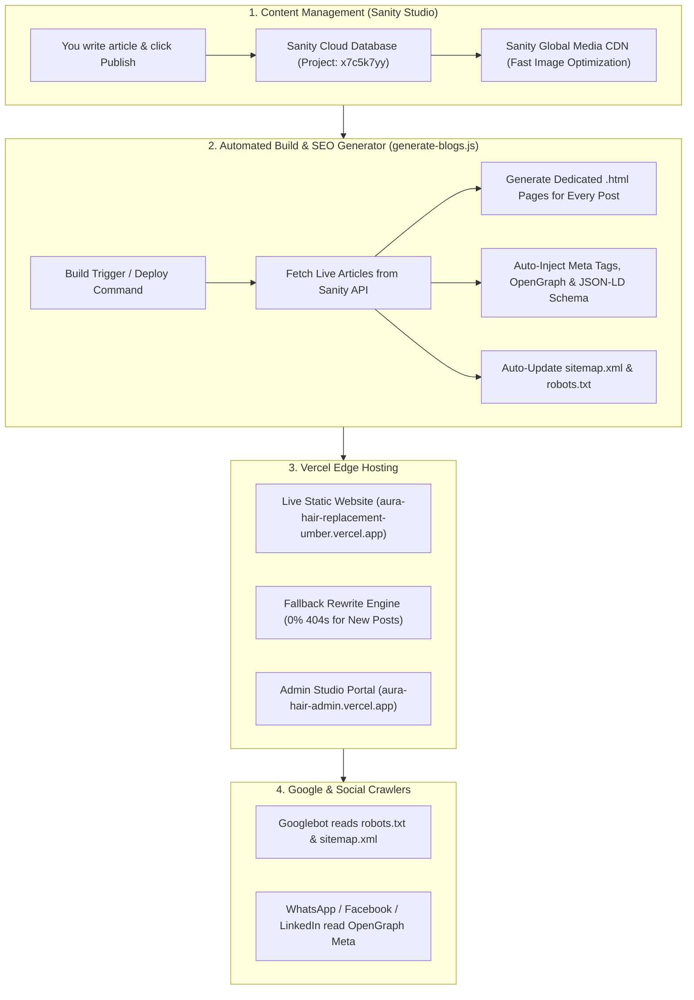

# 📖 AURA Hair Replacement: A to Z Blog, SEO & Vercel Architecture Guide

This document is your complete, beginner-friendly yet technically thorough guide explaining how the **AURA Hair Systems** blog system, automated SEO generation, Vercel deployments, and Google indexing work together seamlessly.

---

## 🏗️ 1. High-Level Architecture Overview

The system is built on a **Modern Hybrid Decoupled Architecture**:



---

## 🌐 2. The Two Vercel Dashboards & Portals

Your setup uses **two linked Vercel applications**:

| Portal | URL | What It Does |
| :--- | :--- | :--- |
| **Main Website** | `https://aura-hair-replacement-umber.vercel.app` | The customer-facing website with services, interactive calculators, contact forms, blog lists, and standalone blog pages. |
| **Admin Blog Studio** | `https://aura-hair-admin.vercel.app` | Your private, password-protected Sanity CMS dashboard where you write, edit, upload photos, and publish blog articles. |

---

## ⚡ 3. The 3-Step SEO Engine: How Every Tag is Auto-Generated

When you hit **Publish** in Sanity, the system automatically translates your content into complete Google and social media SEO tags.

### Step 3.1: Google Search Meta Tags (On-Page SEO)
* **`<title>` Tag:** Combines your article headline with the brand:  
  `"<Your Post Title> | AURA Hair Clinic Delhi"`
* **`<meta name="description">`:** Takes the first 1-2 summary sentences from your **Excerpt** field. Search engines use this for search result snippets.
* **`<link rel="canonical">`:** Automatically set to `https://aura-hair-replacement-umber.vercel.app/<slug>.html` to prevent duplicate content penalties.

### Step 3.2: Social Media & WhatsApp Preview Cards (Open Graph & Twitter)
When anyone copies and pastes your blog link into WhatsApp, Instagram DM, Facebook, or LinkedIn, the platform's preview crawler reads:
* `og:title` ➔ Bold article title
* `og:description` ➔ Article summary
* `og:image` ➔ High-res thumbnail directly from Sanity’s image CDN
* `og:url` ➔ Clean canonical link
* `twitter:card` ➔ `summary_large_image` for large visual cards on X (Twitter)

### Step 3.3: Google Rich Snippet Structured Data (JSON-LD Schema)
Every generated page embeds Schema.org structured data directly in the HTML:
```json
{
  "@context": "https://schema.org",
  "@type": "BlogPosting",
  "headline": "Non-Surgical Hair Patch in Delhi: Complete 2026 Price Guide",
  "description": "Learn about French lace, monofilament, and ultra-thin skin systems...",
  "image": "https://cdn.sanity.io/images/...",
  "author": {
    "@type": "Person",
    "name": "Dr. Meera Sharma"
  },
  "publisher": {
    "@type": "Organization",
    "name": "AURA Hair Systems Clinic"
  }
}
```
* **Why this matters:** Google recognizes this as verified medical/hair expertise, making it eligible for rich cards, Google Discover, and knowledge panels.

---

## 🗺️ 4. How `sitemap.xml` and `robots.txt` Auto-Update

Search engine bots don't guess URLs; they check standard crawler discovery files.

### 1. `sitemap.xml` Auto-Creation
Inside [`generate-blogs.js`](file:///Users/Abhishek/Desktop/Hair%20replacement/generate-blogs.js), every build runs a loop over all articles:
```xml
<?xml version="1.0" encoding="UTF-8"?>
<urlset xmlns="http://www.sitemaps.org/schemas/sitemap/0.9">
  <!-- 1. Home & Blogs Hub -->
  <url>
    <loc>https://aura-hair-replacement-umber.vercel.app/</loc>
    <lastmod>2026-10-09</lastmod>
    <changefreq>daily</changefreq>
    <priority>1.0</priority>
  </url>
  <url>
    <loc>https://aura-hair-replacement-umber.vercel.app/blogs.html</loc>
    <lastmod>2026-10-09</lastmod>
    <changefreq>daily</changefreq>
    <priority>0.9</priority>
  </url>

  <!-- 2. Dynamic Entries for EVERY Published Blog -->
  <url>
    <loc>https://aura-hair-replacement-umber.vercel.app/hair-patch-delhi-guide.html</loc>
    <lastmod>2026-10-09</lastmod>
    <changefreq>weekly</changefreq>
    <priority>0.8</priority>
  </url>
</urlset>
```

### 2. `robots.txt` Pointer
```txt
User-agent: *
Allow: /

Sitemap: https://aura-hair-replacement-umber.vercel.app/sitemap.xml
```
* **How Google uses this:** Googlebot visits `/robots.txt` ➔ finds `sitemap.xml` ➔ sees all newly created blog URLs ➔ crawls and indexes them.

---

## 🛡️ 5. Zero-Downtime & Zero-404 "Hybrid Fail-Safe"

### The Challenge with Pure Static Generators:
If you publish a new article in Sanity at 2:00 PM, but don't run a build until 5:00 PM, visitors clicking the link might get a 404 "Page Not Found".

### Our Solution (The Hybrid Fail-Safe):
We configured [`vercel.json`](file:///Users/Abhishek/Desktop/Hair%20replacement/vercel.json) and [`app.js`](file:///Users/Abhishek/Desktop/Hair%20replacement/app.js) with smart fallback routing:
1. **If the pre-built `.html` file exists:** Vercel serves the blazing fast static file immediately.
2. **If the `.html` file doesn't exist yet (brand new post):** Vercel transparently forwards the request to `blog-post.html`, where `app.js` fetches the content live from Sanity API in milliseconds.
3. **Result:** **0% 404 errors**, instant live updates, and 100% SEO static speed.

---

## 🚀 6. Publishing Workflow: Step-by-Step

Whenever you want to add a new article to your website:

1. Open **[https://aura-hair-admin.vercel.app](https://aura-hair-admin.vercel.app)**.
2. Click **Post** ➔ **Create New (+)**.
3. Fill in the fields:
   * **Title** (e.g. *Best Hair Patch Maintenance Routine*)
   * **Slug** (Click *"Generate"* button)
   * **Main Image** (Upload a high-quality photo)
   * **Excerpt** (1-2 sentence summary for Google)
   * **Body** (Your full formatted article)
4. Click **Publish** (green button at bottom right).
5. **Done!**
   * The article is immediately live at `https://aura-hair-replacement-umber.vercel.app/<your-slug>.html`.
   * It appears automatically on `blogs.html`.
   * On the next deployment/build, a permanent static file is baked into `sitemap.xml`.

---

## 🛠️ 7. Quick Developer Cheat-Sheet

* **Run generator locally:**
  ```bash
  npm run generate-blogs
  ```
* **Deploy changes to Vercel production:**
  ```bash
  npx -y vercel --prod --yes
  ```
* **Submit Sitemap to Google:**
  * Go to [Google Search Console](https://search.google.com/search-console)
  * Enter URL: `https://aura-hair-replacement-umber.vercel.app/sitemap.xml`
